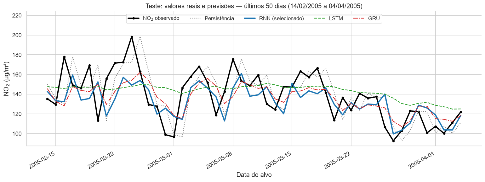
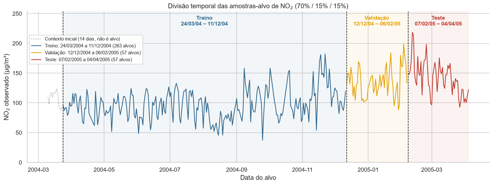
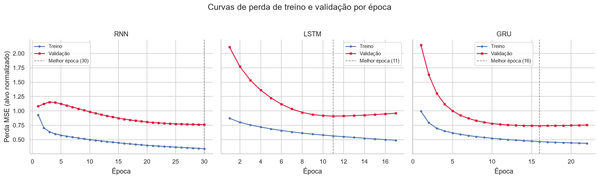

# Previsão de NO₂ com RNN, LSTM e GRU

Comparação de três redes recorrentes (RNN simples, LSTM e GRU) e de um baseline de persistência na previsão da concentração média diária de dióxido de nitrogênio (NO₂) do dia seguinte, usando apenas os 14 dias anteriores de quatro poluentes.

Trabalho desenvolvido na disciplina *Artificial Intelligence & Deep Learning Applications* da FIAP (Global Solution 02/2026, tema CitizenTech).

**Autores:** Elton Vinicios Almeida de Oliveira, Emerson dos Santos Silva e Kelvin Douglas Ribeiro Rabelo.

## Resultado principal

| Abordagem | Parâmetros | MAE validação | RMSE validação | MAE teste | RMSE teste |
|:---|---:|---:|---:|---:|---:|
| Persistência (repete o dia anterior) | 0 | 19,14 | 24,60 | 18,78 | 24,09 |
| **RNN simples (escolhida)** | 353 | **16,72** | 21,91 | **18,66** | 24,01 |
| LSTM | 1.361 | 19,73 | 23,93 | 18,73 | 24,93 |
| GRU | 1.073 | 16,74 | 21,60 | 17,15 | 22,23 |

Erros em µg/m³.

- A RNN foi escolhida pelo menor MAE de validação, antes de qualquer consulta ao teste.
- No teste a ordem mudou: a GRU foi a melhor e a RNN quase empatou com a persistência (−0,6%). A escolha não foi trocada depois do teste; a divergência está registrada como limitação.
- A persistência ficou muito competitiva: quase toda a previsibilidade de um dia para o outro vem de o NO₂ de hoje se parecer com o de ontem.



## O problema

- **Entrada:** janela com 14 dias de NO₂, NOx, CO e benzeno (formato `14 × 4`).
- **Saída:** NO₂ médio do dia seguinte, em µg/m³.
- **Restrição:** nenhuma medição do próprio dia previsto entra na janela.

## Dados

*Air Quality* (UCI Machine Learning Repository): médias diárias de 391 dias consecutivos, de 10/03/2004 a 04/04/2005, medidos em uma cidade italiana. O arquivo `qualidade_do_ar_diario.csv` traz as médias diárias com pequeno arredondamento.

- Fonte primária: Vito, S. (2008). *Air Quality*. UCI Machine Learning Repository. https://doi.org/10.24432/C59K5F (licença CC BY 4.0).
- Agregação diária: repositório [mathewchalo7/AirQualityAnalysis](https://github.com/mathewchalo7/AirQualityAnalysis), arquivo `daily_avg_pollutants.csv`.

## Metodologia

1. **Diagnóstico:** sem valores ausentes, datas repetidas ou dias faltando; não foi preciso imputar.
2. **Janelas e divisão:** 377 amostras, divididas em ordem cronológica pela data do alvo, sem embaralhar.

   | Conjunto | Amostras | Período dos alvos |
   |:---|---:|:---|
   | Treino | 263 | 24/03/2004 a 11/12/2004 |
   | Validação | 57 | 12/12/2004 a 06/02/2005 |
   | Teste | 57 | 07/02/2005 a 04/04/2005 |

3. **Normalização:** `StandardScaler` para as entradas e outro para o alvo, ajustados apenas com o treino.
4. **Modelos:** a mesma arquitetura nas três redes, mudando só a célula recorrente.

   | Item | Valor |
   |:---|:---|
   | Arquitetura | entrada `(14, 4)` → camada recorrente de 16 unidades → `Dense(1)` linear |
   | Otimizador | Adam, taxa 0,001 |
   | Perda | MSE no alvo normalizado |
   | Lote / épocas | 16 / no máximo 30 |
   | Parada antecipada | `val_loss`, paciência 6, restaura os melhores pesos |
   | Semente | 42, reaplicada antes de cada rede |

5. **Seleção e teste:** candidato escolhido pelo menor MAE de validação (desempate: menos parâmetros), registrado antes do teste. MAE e RMSE sempre na unidade original.





## Limitações

- Uma única configuração e uma única semente por rede; diferenças pequenas, como os 0,02 µg/m³ entre RNN e GRU na validação, não são conclusivas.
- A RNN atingiu a melhor época no limite de 30 épocas, então seu resultado depende desse teto.
- Validação e teste têm só 57 dias cada, e o nível de NO₂ muda bastante entre treino (verão e outono) e validação/teste (inverno).
- A base cobre um ano de uma cidade italiana em 2004–2005. O modelo não deve ser usado para orientar pessoas sem validação com dados locais e recentes.

## Como executar

```bash
pip install -r requirements.txt
```

```bash
jupyter nbconvert --to notebook --execute --inplace previsao_no2_rnn_lstm_gru.ipynb
```

Ou abra o notebook no VS Code ou no Jupyter e execute todas as células. Leva cerca de um minuto em CPU, sem GPU. Em outro computador ou outra versão do TensorFlow, os números podem variar um pouco.

## Estrutura

| Arquivo | Conteúdo |
|:---|:---|
| `previsao_no2_rnn_lstm_gru.ipynb` | Notebook completo, já executado, com código, análises e gráficos |
| `qualidade_do_ar_diario.csv` | Médias diárias dos quatro poluentes |
| `figuras/` | Gráficos exportados do notebook |
| `requirements.txt` | Versões das bibliotecas usadas |
